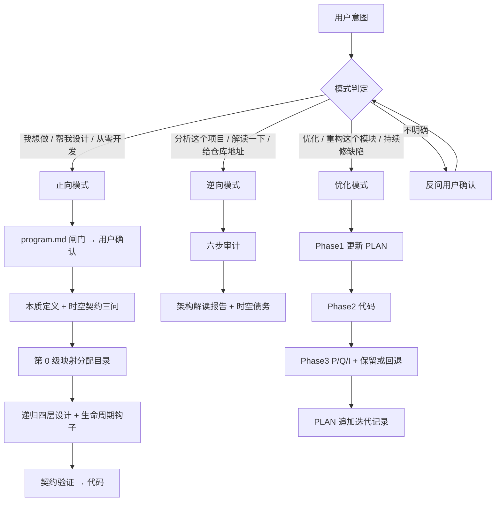

# project-dev · 项目开发方法论 Skill

> **一个用「时空 + 规则」公理驱动 AI 做完整软件项目的技能包。**
> 正向设计（从零生成）、逆向解读（分析已有）、优化迭代（持续改进）——三种模式，一站编排。
>
> 语言无关、形态无关：Rust / Python / Go / Java / TypeScript，单体业务 / OS 内核 / AI Agent 框架，全都适用。

<p>
  <a href="#-许可证"></a>
  
  
</p>

---

## 这是什么

`project-dev` 是一份**给 AI Agent 用的项目级工作方法论**。它把「怎么把一个软件项目从想法做到交付」拆成可执行、可验证、可复盘的流程契约：

- 面对**新需求** → 走**正向模式**：先立契约，再写代码，绝不"边想边写"。
- 面对**已有代码** → 走**逆向模式**：从源码还原它的时空设计，产出架构解读报告。
- 面对**存量项目改进** → 走**优化模式**：把审计结论沉淀成模块级 `PLAN.md`，按方案迭代。

它不是"提示词模板"，而是一套**带硬门槛与收敛判据的工程纪律**：模式判定、公理校验、依赖铁律、生命周期钩子、验收闭环，每一步都有明确的"不通过就停"。

---

## 为什么特别（特点）

### 1. 底层锚在物理公理上，而不是"最佳实践"

一切系统都被还原成三个不可绕过的维度：

| 维度 | 物理本质 | 软件体现 |
|---|---|---|
| **空间** | 内存里开辟的数据块 | 变量/对象/表/文件；所有权（Rust Ownership） |
| **时间** | 指令指针在地址间的移动 | 调用栈、事件循环、状态机、调度队列 |
| **规则** | 硬件运算 + 软件附加约束 | 类型系统、Trait/Interface、沙箱、借用检查 |

由此推出一个**极简推论**——**运行时 / 内核 = 时空管家**：开辟空间（init/注册）、编排时间（主循环/调度）、强制规则（拦截越界）。

> 因为锚在物理层，方法论**语言无关、形态无关**：不管你在写业务后端、OS 内核还是 Agent 框架，都是同一套拆解方式。

### 2. 递归四层模型：任意粒度都能拆

任何代码单元（项目 / 模块 / 类 / 函数）都遵循同一组四层结构：

```
数据规范 → 数据存储 → 数据流转 → 数据接口
（放什么）  （落在哪）  （怎么变）  （谁进来）
```

- 递归展开时**强制锚定父本质**（"在{父本质}约束下，本模块本质是…"），超过 3 层终止。
- 从项目级到函数级，同一把尺子量到底，避免"大模块能说清、小模块说不清"。

### 3. 第 0 级目录映射 + 依赖铁律（防越界）

项目级直接给出六层时空映射与职责边界：

| 层级 | 目录 | 时空职责 |
|---|---|---|
| 数据规范（规则基座） | `core/` | 纯规则定义，不依赖任何人 |
| 数据存储（空间落地） | `infrastructure/` | 空间持久化，只依赖 core 抽象 |
| 流转-规则（业务时空） | `domain/` | 业务规则，不直依赖基础设施实现 |
| 流转-编排（调度时空） | `application/` | 组装业务时间线 |
| **运行时/内核（时空管家）** | `runtime/` | 显式 `init/start/stop/destroy` + 主循环 |
| 数据接口（时空入口） | `interfaces/` | 把外部事件转化为内部调用 |

**三条依赖铁律**（空间防越界 / 时间防乱序 / 规则防穿透），并明确：`runtime/` 层缺失 = 最高级技术债。

### 4. 硬门槛：契约没确认，不许动工

- 正向模式的 **`program.md` 闸门**：没有 `program.md` 就先产出草稿（目标 / 语言 / P·Q·I 具体值 / 修改范围 / 约束 / 研究方向），**用户确认前不进入设计**。
- **本质定义必须自答三条时空契约**：核心数据谁独占？主执行流是顺序管道、事件循环还是状态机？越界由编译期还是运行时拦？
- 首行声明 `探索`（只出精简方案 + 代码）或 `生产`（完整文档树），规模可控。

### 5. 逆向模式：六步审计，产出结构化报告

从源码出发，不靠猜、靠证据：

```
① 本质逆向定义 + 时空契约还原
② 第 0 级分层审计（runtime 缺失 = 最高债务）
③ 执行流类型识别（顺序 / 事件循环 / 状态机 / 混合）
④ 模块递归拆解（标注生命周期钩子实际落点）
⑤ 依赖方向审计（三条铁律逐条核查）
⑥ 验证契约审计（现有测试 vs P/Q/I 覆盖）
```

产出《架构解读报告》固定结构：概览 → 本质与契约还原 → 执行流 → 分层审计表 → 依赖违规清单 → 时空债务汇总 → 短中长期改进建议。

### 6. 优化模式：PLAN.md 迭代纪律

- 方案**随代码走**（落在模块目录内，如 `crates/{module}/PLAN.md`），不新增构建期编号文档。
- `PLAN.md` = 演进轨迹（审计结论 / 路线 / 迭代记录）；`README.md` = 对外契约（只在契约真变时同步）。
- **失败归档**：评估过但不做的方案记入「已评估不做」，杜绝重复尝试。
- **跨模块节奏**：先修规则层（正确性）→ 再修时间层（效率/健壮性）→ 最后工程面收敛。

### 7. 体量治理：大文件拆分有章法

- 审计门槛"**行数只是引子，域混杂才是依据**"——内聚单一的 1000 行好过职责混杂的 600 行。
- 产出三清单：**拆分 / 不拆 / 缓拆**（各自锁定结论或触发条件，防反复评估）。
- 拆分纪律：**纯搬家、零逻辑改动**；按域内聚切；契约兼容优先（re-export 零改动）；**逐项验证拆分引入的新语义边界**（这是拆分事故的主要来源）。

### 8. P/Q/I 验收闭环 + 时空闭环三问

```
前置条件 P（空间是否就绪）→ 后置条件 Q（时间流是否走通）→ 不变量 I（规则是否守住）
```

- 判定逻辑明确：P❌ 阻断；Q❌ 回退；I❌ 回退；全 ✅ 才保留（commit）。
- 协同 LLM 产品额外增加 `validate_llm()` 维度。
- **时空闭环三问**：所有 init 都有对应 destroy 吗？主循环有不可退出的死循环吗？有跨层直访内存吗？

### 9. 工程纪律内建

- **先设计后代码**：每段代码标注所属时空层级，新模块必须显式写 `init` 和 `destroy`（或语言等效物）。
- **Diff 纪律**：改动 ≤ 50 行直接进测试；> 50 行必须先出《大范围改动合理性说明》并获确认。
- **简洁优先**：不加未要求的辅助函数 / 装饰器 / 抽象层；不引入技术栈决策之外的依赖。

### 11. Agent-First 调用面：读懂 = 还原设计 + 知道怎么调用

agent 消费软件靠**调用**而非阅读（v0.3.0 新增）：

- **正向**：`program.md` 闸门新增「主要消费者（人 / agent / 两者）」确认项；消费者含 agent 时，interfaces 层按调用面契约设计——子命令式 CLI 优先、`--json` 稳定 schema、退出码表、stdout/stderr 流分离、免交互无 TTY 依赖、幂等与 `--dry-run`。
- **逆向**：分层审计的数据接口层附查「可调用面」：外部入口清单、`--help` / `--json` / 退出码现状、agent 能否非交互驱动核心用例、缺口按补齐成本排序（包 CLI 子命令 → 参数化输入 → 拆交互依赖）。
- **演进**：CLI 是 agent 调用的最低公约数（确定性、可组合、退出码可判）；宿主支持 MCP 后，可把成熟 CLI 薄封装为 MCP server（子命令 ↔ tool），两者不冲突。
- 细则见 `skills/project-dev/references/project-development-prompt.md` §3.6。

### 10. 自举验证：它自己就是用它自己写出来的

本方法论并非空想产物——它从参考项目的真实开发过程中沉淀而来，而参考项目的方案文档、模块设计、`PLAN.md` 迭代记录，**全部按这套方法产出**。方法论与产物互为验证。

---

## 三种模式一览



---

## 目录结构

```
project-dev-skill/
├── README.md
├── LICENSE
└── skills/
    ├── project-dev/                     ← 编排层（入口技能）
    │   ├── SKILL.md                     ← 模式判定 / 阶段路由 / 纪律速查
    │   ├── PLAN.md                      ← 演进轨迹（审计结论 / 迭代记录 / 已评估不做）
    │   ├── skill.json / state.json      ← 技能契约与状态机
    │   ├── evals/                       ← 案例回放与基线（cases.jsonl + results/）
    │   └── references/
    │       └── project-development-prompt.md   ← 权威全文（公理 + 四层 + 报告模板）
    ├── repo-explorer/                   ← 配套：逆向阅读（快速建图 + 六步深读）
    │   └── SKILL.md
    └── tdd/                             ← 配套：验证执行器（run_tests 工具）
        ├── SKILL.md
        ├── tools.json
        └── run_tests.py
```

三个技能是**协作关系**：`project-dev` 是编排层，把「怎么读仓库」路由给 `repo-explorer`、把「怎么跑测试」路由给 `tdd`；三者的完整公理体系与模板都在 `project-dev/references/project-development-prompt.md`。

### 作为「源仓库」使用：与部署副本的一致性

本仓库是这三门技能的**唯一权威源**。把它们装进某个 Agent 运行时后，`<运行时>/skills/{project-dev,repo-explorer,tdd}/` 只是部署副本，容易悄悄落后。若你的运行时是 [rsi-agent](https://github.com/zh2673-git/rsi-agent)，它已把本仓库登记进源仓库表，可机检漂移：

```bash
python scripts/sync_skills.py --check   # 逐文件比对（对 CRLF/LF 与 BOM 不敏感），漂移则退出码非 0
python scripts/sync_skills.py --sync --skill tdd --write   # 源仓库 → 部署副本（默认 dry-run）
```

反向（部署副本更新、要回流本源仓库）没有自动脚本，请手工同步并立刻 `--check` 复核：`--sync` 只会覆盖部署副本，不会把运行时的本地改动带回来。

仓库自用资产（`README.md` / `LICENSE` / `docs/`）不下发到部署副本，不参与比对。

---

## 安装与使用

技能采用开放的 `SKILL.md` 标准（YAML frontmatter + Markdown 正文）。把 `skills/` 下的目录放进你的 Agent 技能目录即可：

```bash
# 通用做法：克隆后把技能目录拷进你的 skills 根
git clone https://github.com/zh2673-git/project-dev-skill.git
cp -r project-dev-skill/skills/* <你的 skills 目录>/
```

```powershell
# Windows PowerShell
git clone https://github.com/zh2673-git/project-dev-skill.git
Copy-Item -Recurse .\project-dev-skill\skills\* "<你的 skills 目录>\"
```

触发方式：直接对 Agent 说

- 「我想做一个 ……（从零开发）」→ 走正向
- 「帮我分析 / 解读一下这个项目」或给出仓库地址 → 走逆向
- 「优化 / 重构这个模块」→ 走优化

> `tdd` 技能附带 `run_tests` 配套工具，需在宿主中装载并启用（装载 ≠ 启用，是两步）。

---

## 出处：本项目

本方法论从 **[react-agent](https://github.com/zh2673-git/react-agent)** 的开发过程中沉淀而来 —— 一个基于自研内核 **[agent-kernel](https://github.com/zh2673-git/agent-kernel)** 构建的生产级 ReAct Agent（Rust 编排 + Python/TS 跨语言插件 + Web/REPL 双前端）。

在 react-agent 仓库里可以看到本方法论**完整落地**的样子：

- `docs/01-08` —— 正向模式产出的完整文档树（项目方案 / 架构设计 / 模块设计 / 各模块四层设计）；
- `crates/*/PLAN.md`、`plugins/*/PLAN.md` —— 优化模式的演进轨迹（审计结论 + 迭代记录 + 已评估不做）；
- `plugins/assets/skills/project-dev/` —— 本技能在项目内的原始分发形态。

> 也就是说：**react-agent 既是本方法的试炼场，也是它的参考实现。** 想验证这套方法论是否有效，去看它的产物即可。

---

## 许可证

[MIT](./LICENSE) © 2026 zh2673-git

欢迎自由使用、修改与二次分发；如果它帮你把项目做顺了，欢迎回到 [react-agent](https://github.com/zh2673-git/react-agent) 点个 ⭐。
